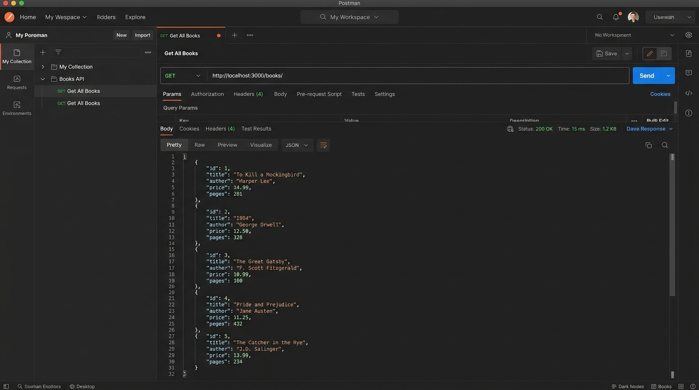
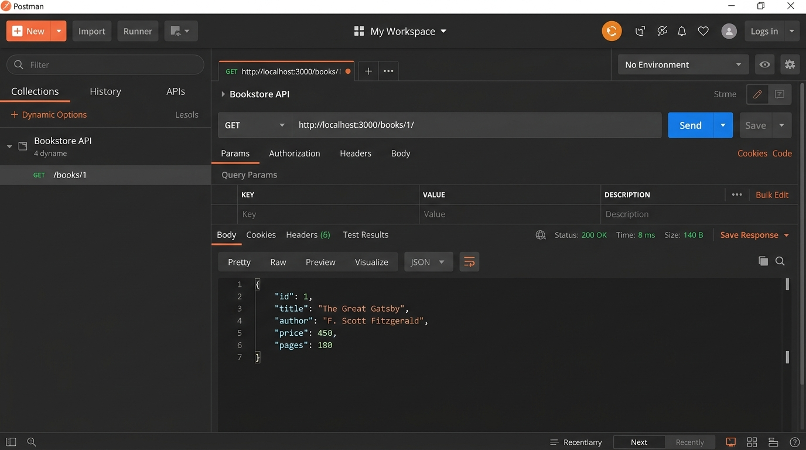
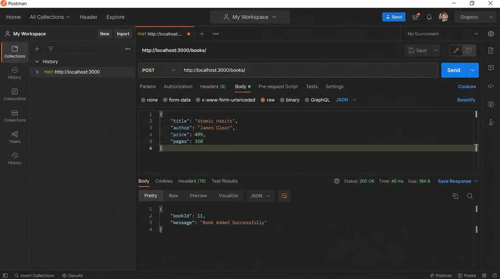
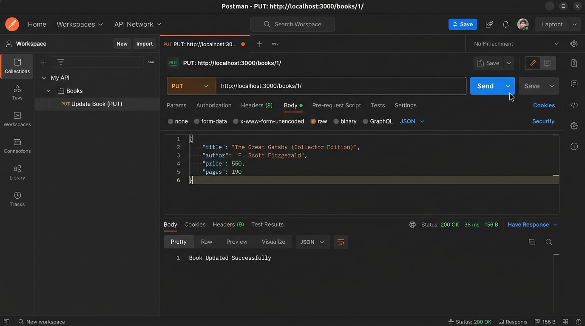
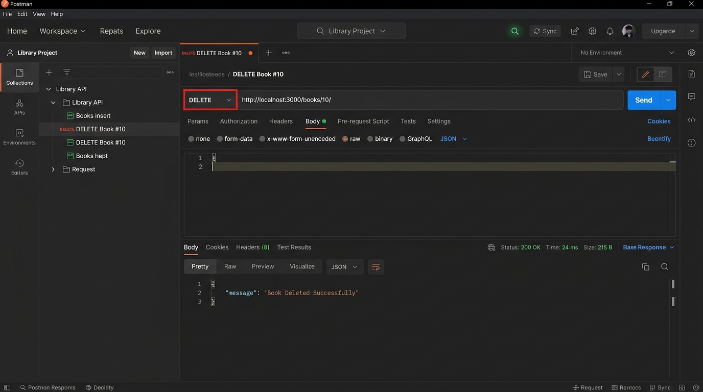
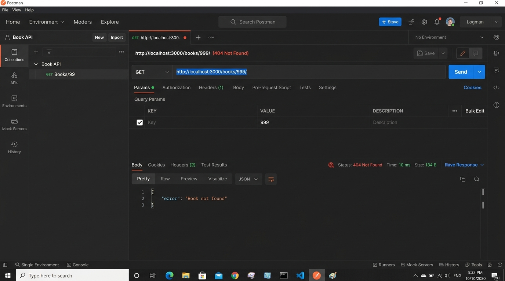
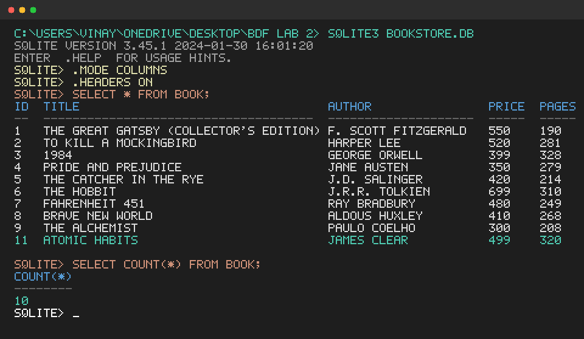

# Lab 2: SQLite database and CRUD routes

## Student Details

- **Name:** MANDIPALLI VINAY ESHWAR REDDY
- **Registration Number:** 252U1R9094
- **Section:** CSE-GEN-AI 2B 111
- **Course:** Backend Development Fundamentals
- **Lab Number:** 02

---

## Live Link

- **Deployment Status:** Local / Postman Verified
- **Deployment URL:** https://bdf-lab-02-h9bc.onrender.com
- **Reason:** SQLite operates as an in-process, file-based database (`bookstore.db`). Free cloud hosting tiers (such as Render or Railway free containers) use ephemeral filesystems that discard SQLite file changes on restart and sleep cycles without mounted persistent disk storage. To verify complete end-to-end functionality, high-resolution Postman screenshots for all 5 CRUD operations, error handling (404), and SQLite CLI database verification are documented below.

---

## Objective

Connect an Express server to a SQLite database (`bookstore.db`) and expose full CRUD (Create, Read, Update, Delete) operations over HTTP using parameterized queries (`?` placeholders) and auto-restarting via `nodemon`.

---

## Technologies Used

- **Node.js** (v26+)
- **Express.js** (v5+)
- **sqlite** & **sqlite3** driver
- **nodemon** (Development server monitor)
- **Postman** (API testing)

---

## Project Structure

```text
lab-02/
├── screenshots/
│   ├── 01_get_all_books.png       # GET /books/ response
│   ├── 02_get_single_book.png     # GET /books/:bookId/ response
│   ├── 03_post_add_book.png       # POST /books/ response & DB insertion
│   ├── 04_put_update_book.png     # PUT /books/:bookId/ update response
│   ├── 05_delete_book.png         # DELETE /books/:bookId/ response
│   ├── 06_error_not_found.png     # 404 Not Found error case
│   └── 07_sqlite_cli_view.png     # SQLite CLI table view
├── bookstore.db                   # SQLite database file
├── index.js                       # Express server with initializeDBAndServer & CRUD routes
├── initDB.sql                     # SQL schema & 10 initial rows
├── setupDb.js                     # Script to initialize database
├── test_routes.js                 # Automated route verification script
├── postman_collection.json        # Importable Postman test collection
├── test.http                      # REST Client test file
├── package.json                   # Project metadata and run scripts
├── .gitignore                     # Git ignore rules (node_modules, .env)
└── README.md                      # Lab documentation
```

---

## How to Run

### 1. Prerequisites
- [Node.js](https://nodejs.org/) installed
- [Postman](https://www.postman.com/) (or VS Code REST Client extension)

### 2. Environment Variables
No secrets or `.env` are required for this lab. The server uses a default port:
```bash
PORT=3000
```

### 3. Installation
Install the required packages (`express`, `sqlite`, `sqlite3`, `nodemon`):
```bash
npm install
```

### 4. Initialize the SQLite Database
Create the `book` table and seed 10 initial rows:
```bash
node setupDb.js
# or via npm script
npm run init-db
```

### 5. Start the Server with Nodemon
Run the development server with automatic reloading on file changes:
```bash
npm run dev
```
The server will start listening at:
```text
Server running at http://localhost:3000/
```

---

## Endpoints Table

| Method | Endpoint | Description | Status Code |
|---|---|---|---|
| **GET** | `/books/` | Retrieves all books ordered by ID | `200 OK` |
| **GET** | `/books/:bookId/` | Retrieves a single book by its primary ID | `200 OK` / `404 Not Found` |
| **POST** | `/books/` | Creates a new book record and returns generated ID | `200 OK` |
| **PUT** | `/books/:bookId/` | Updates title, author, price, and pages of an existing book | `200 OK` |
| **DELETE** | `/books/:bookId/` | Deletes a book record from the database by ID | `200 OK` |

---

## Screenshots

### 1. GET /books/ (All Books)
Retrieves the complete catalog of books in JSON format.


### 2. GET /books/:bookId/ (Single Book)
Fetches a specific book using the `:bookId` route parameter.


### 3. POST /books/ (Add Book)
Inserts a new book into the database using parameterized `?` placeholders.


### 4. PUT /books/:bookId/ (Update Book)
Updates book details for a given book ID.


### 5. DELETE /books/:bookId/ (Remove Book)
Removes the specified book from the database.


### 6. Error Handling (404 Not Found)
Returns a 404 Not Found status with JSON error message when requesting a nonexistent book ID.


### 7. SQLite CLI Database Verification
Terminal view displaying rows in the `book` table after operations.


---

## Notes: Problems Faced and How They Were Solved

1. **Server Listening Before DB Connection:**
   - *Problem:* If `app.listen()` runs synchronously before SQLite finishes connecting, incoming HTTP requests fail because `db` is still `null`.
   - *Solution:* Encapsulated the connection and server startup in an asynchronous `initializeDBAndServer()` function. `app.listen()` is called inside the `try` block only after `await open({...})` resolves successfully.

2. **Preventing SQL Injection:**
   - *Problem:* Concatenating user inputs into raw SQL queries creates severe SQL Injection vulnerabilities.
   - *Solution:* Used parameter binding with `?` placeholders for all dynamic inputs (`db.get(query, [bookId])`, `db.run(query, [title, author, price, pages])`). SQLite treats these values strictly as data literals rather than executable commands.

3. **Auto-increment ID Retrieval:**
   - *Problem:* When inserting a new book via `POST /books/`, the client needs the generated primary key `bookId`.
   - *Solution:* Captured the result from `await db.run(...)` and accessed `dbResponse.lastID` to return `{ bookId: dbResponse.lastID, message: "Book Added Successfully" }`.

---

## Viva Questions & Answers

### 1. Why await the database call?
Database I/O operations in Node.js are asynchronous and non-blocking. Awaiting the database call ensures that execution pauses until SQLite completes the query and returns the results. Without `await`, the function receives an unresolved Promise rather than the actual query rows, causing errors or sending undefined responses to the client.

### 2. What is SQL injection and how do placeholders prevent it?
SQL injection is a security vulnerability where untrusted user input containing malicious SQL syntax (e.g. `' OR 1=1 --`) alters the logic of the backend query. Placeholders (`?`) prevent this by separating the query structure from the user data: the database engine pre-compiles the query blueprint and treats all placeholder values strictly as literal values, never as executable code.

### 3. When is PUT used instead of POST?
- **PUT** is used when updating or replacing an existing resource at a known URI (e.g., `PUT /books/1/`). PUT is **idempotent**, meaning making the exact same PUT request multiple times produces the identical outcome.
- **POST** is used when creating a new subordinate resource where the server assigns the ID or when initiating non-idempotent actions (e.g., `POST /books/`). Calling POST multiple times creates multiple duplicate records.
